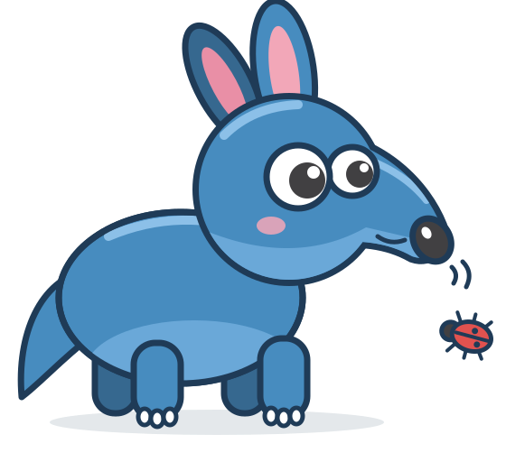

<div align="center">



# gdtest

**Fast, typed, isolated GDScript tests for Godot 4.7.**

A Go CLI and a warm, user-level daemon, with persistent headless Godot workers.
Your test runs skip the engine boot and get results back in milliseconds.

[](https://github.com/cafecito-games/gdtest/actions/workflows/ci.yml)
[](https://github.com/cafecito-games/gdtest/releases)
[](https://godotengine.org)
[](LICENSE)

[Getting started](docs/getting-started.md) ·
[API specification](api-spec.md) ·
[CI setup](docs/ci.md) ·
[Migrating from Vest](docs/vest-migration.md)

</div>

---

```gdscript
extends GDTest


## Verifies the inventory total.
func test_total() -> void:
	expect_equal(2 + 2, 4)
```

```console
$ ./addons/gdtest/gdtest run
1 passed, 0 failed, 0 errors, 0 skipped, 0 todo, 0 void, 0 canceled
```

## Why gdtest?

- **⚡ Warm by default.** A user-level daemon keeps headless Godot workers alive between runs, so
  the engine doesn't boot again for each run. On the reference machine, a complete warm CLI
  invocation has a median of about **28 ms** ([measurements](docs/performance.md)).
- **🧱 Isolated.** Every Git worktree gets its own worker, and each lane gets its own `user://`
  storage. Two dirty worktrees can run tests at the same time without sharing state.
- **🎯 Affected tests only.** Pass the files you changed with `--affected` and gdtest runs only the
  tests that depend on them. When it can't be sure, such as with an unknown dynamic load, it runs
  more tests, never fewer.
- **🔒 Typed.** Tests, providers, hooks, probes, and generated doubles are all statically typed
  GDScript.
- **🤖 CI-ready.** Exit codes are stable, `--json` emits JSON Lines events, and `--no-daemon` runs
  everything in the foreground for hermetic builds.
- **🔁 Easy to adopt.** `gdtest migrate vest` converts an existing Vest suite mechanically and
  reports anything it could not convert, with the exact location.

## Install

Install a versioned release as a host development tool with gpm:

```sh
gpm init # only when addons.toml does not exist
gpm add --name gdtest \
  --source github-release \
  --repo cafecito-games/gdtest \
  --version <tag> \
  --host-tool
```

`--host-tool` writes `platforms = []`. Mobile and web export targets then skip the gdtest binaries,
and gpm still installs the executable for your host. Commit `addons.toml` and `addons.lock`, but
not `.gpm-state.toml`. Then run the project-local executable; no global install is needed:

```sh
./addons/gdtest/gdtest run
```

<details>
<summary>Older gpm, CI installs, and platform support</summary>

`--host-tool` requires gpm 0.6.0 or newer. With an older gpm, add the equivalent manifest entry
and run `gpm install`:

```toml
[addons.gdtest]
source = "github-release"
repo = "cafecito-games/gdtest"
version = "<tag>"
platforms = []
```

CI and disposable worktrees can use `gpm install --host-only`. For ordinary CI installs, always
use `gpm install`, never `gpm update`.

Releases cover macOS and Linux on arm64 and x86_64. Windows release slices are on hold until the
user-level daemon has a validated Windows transport and Windows CI coverage.

</details>

## A quick tour

Name test files `*.test.gd` and extend `GDTest`. The sections below show the main building blocks.
The [API specification](api-spec.md) has the full contract.

### Parameterized cases

A provider named `<test>__cases` turns each row into a separate case with its own stable ID:

```gdscript
func test_adds(left: int, right: int, expected: int) -> void:
	expect_equal(left + right, expected)


func test_adds__cases() -> Dictionary[String, Array]:
	return { "small": [1, 2, 3], "zero": [0, 0, 0] }
```

### Dynamic suites and async cases

Register suites and cases at discovery time. Cases and hooks can `await`:

```gdscript
func suite() -> void:
	test_each("adds numbers", {
		"positive": [2, 3, 5],
		"negative": [-2, -3, -5],
	}, func(a: int, b: int, expected: int) -> void:
		expect_equal(a + b, expected)
	)

	test("async dynamic case", func() -> void:
		await sleep()
		expect_true(true)
	)
```

### Signal and callback probes

Record signal emissions and injected callbacks. Every probe in a case shares one sequence
counter, so a test can check the order in which things happened:

```gdscript
func test_awaits_injected_completion_callback() -> void:
	var checkout: CheckoutFlow = CheckoutFlow.new(Inventory.new(3), get_tree())
	var stages: GDTestSignalProbe = watch_signal(checkout.stage_reached)
	var on_complete: GDTestCallbackProbe = callback_probe(2)
	var on_error: GDTestCallbackProbe = callback_probe(1)

	checkout.purchase_async("apple", 2, on_complete.callback(), on_error.callback())

	expect_true(await on_complete.wait_until_count(1, 1.0))
	expect_equal(on_complete.arguments_at(0), ["apple", 2])
	expect_equal(stages.emission_count(), 2)
	expect_equal(on_error.invocation_count(), 0)
```

### Generated test doubles

List doubles under `test_doubles` in `gdtest.json`, then generate them ahead of time. The output is
plain, typed GDScript that you commit:

```sh
./addons/gdtest/gdtest generate doubles
./addons/gdtest/gdtest generate doubles --check   # exits 1 when missing, stale, or unexpected
```

```gdscript
func test_queued_results_are_consumed_in_order_then_last_is_sticky() -> void:
	var inventory: InventoryDouble = InventoryDouble.new(double_context(), 3)
	var shop: Shop = Shop.new(inventory)
	inventory.gdtest.add.then_return(true)
	inventory.gdtest.add.then_return(false)

	expect_true(shop.stock("apple"))
	expect_false(shop.stock("pear"))
	expect_equal(inventory.gdtest.add.call_count(), 2)
```

Doubles also support `then_answer`, `then_call_real`, and async answers. See the
[test double specification](api-spec.md#147-generated-test-doubles).

### Informational benchmarks

Put typed `benchmark_*() -> void` methods in a `*.bench.gd` script that extends `GDTestBenchmark`.
Benchmarks run separately from correctness tests:

```sh
./addons/gdtest/gdtest bench
./addons/gdtest/gdtest bench --write-baseline benchmark-baseline.json
./addons/gdtest/gdtest bench --compare benchmark-baseline.json
```

Warmups and hooks are not timed, and the raw normalized samples are kept. A comparison never
fails because of a timing difference.

## Command line

| Command | What it does |
| --- | --- |
| `gdtest run [selectors...]` | Run tests. Select by file, `file::case` stable ID, or `--name` |
| `gdtest run --affected a.gd,b.tres` | Run only the tests affected by the listed changes |
| `gdtest watch` | Re-run tests when project sources change |
| `gdtest list` | List discovered tests |
| `gdtest bench` | Run `*.bench.gd` benchmarks, with optional baselines |
| `gdtest generate doubles` | Generate typed test doubles from `gdtest.json` |
| `gdtest migrate vest --check` / `--write` | Preview or apply a Vest migration |
| `gdtest warm` | Start the daemon and warm the project worker ahead of time |
| `gdtest doctor` | Check the local installation |

```sh
./addons/gdtest/gdtest run tests/inventory.test.gd
./addons/gdtest/gdtest run 'tests/inventory.test.gd::test_total'
./addons/gdtest/gdtest run --name total
./addons/gdtest/gdtest run --affected src/inventory.gd,resources/items.tres --verbose
```

If no tests are affected, `--affected` succeeds and prints `no tests were affected`.

**Exit codes** are stable: `0` ok · `1` test failures or strict-policy violations · `2`
configuration, discovery, protocol, worker, or reporting error · `130` canceled.

## Worktrees and CI

The daemon keys each session by canonical repository and worktree identity. Simultaneous dirty
worktrees therefore never share a Godot worker. Incompatible gdtest builds never share a daemon
socket.

In CI, use `--json` and keep its JSON Lines output. Use `--no-daemon` to debug a run hermetically
in the foreground. See [worktree usage](docs/worktrees.md) and [CI setup](docs/ci.md).

## Migrating from Vest

```sh
./addons/gdtest/gdtest migrate vest --check
./addons/gdtest/gdtest migrate vest --write
```

The migration uses gdparser syntax spans, so it leaves unsupported source unchanged and reports
each manual finding at its exact location. The [Vest migration guide](docs/vest-migration.md)
lists the API map and recipes for manual conversions.

## Documentation

| | |
| --- | --- |
| [Getting started](docs/getting-started.md) | First project, first test, first run |
| [API specification](api-spec.md) | The authoritative GDScript contract |
| [Architecture](spec.md) | How the CLI, daemon, scheduler, and workers fit together |
| [Worktrees](docs/worktrees.md) | Parallel worktree usage |
| [CI](docs/ci.md) | Running gdtest in pipelines |
| [Performance](docs/performance.md) | Reference measurements and methodology |
| [Vest migration](docs/vest-migration.md) | Automated and manual migration |
| [Examples](examples/basic) | Runnable tests, benchmarks, probes, and doubles |

## Development

You need Go 1.26, Godot 4.7, gdkit 0.10.0 or newer, golangci-lint v2, and gpm 0.6.0 or newer. Run
`scripts/check` before committing. [CONTRIBUTING.md](CONTRIBUTING.md) covers packaging,
benchmarks, and the full local workflow.

## License

[MIT](LICENSE) © Cafecito Games LLC
